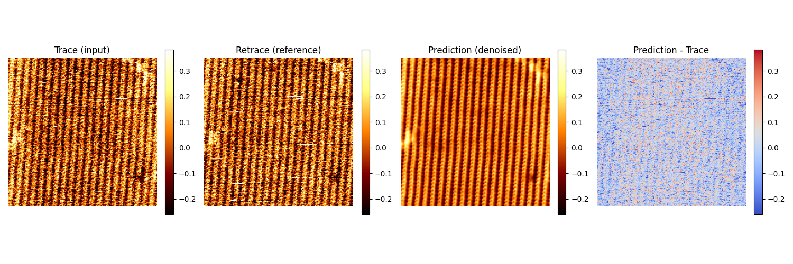
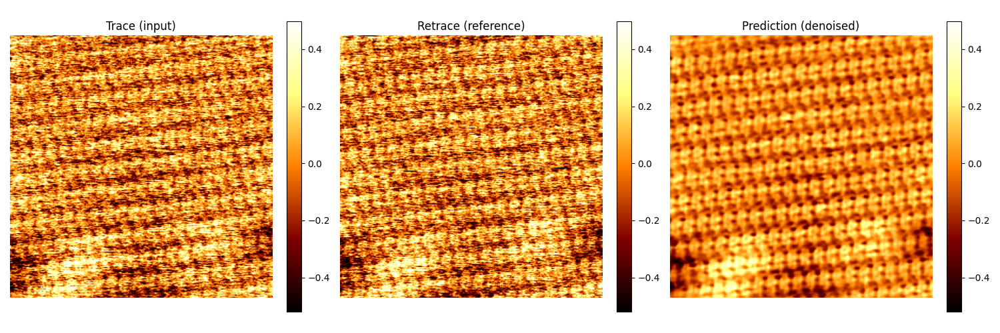

# VIPER

**Self-supervised AFM image denoising with early-stopping regularization**

[](https://github.com/PNAILab-CSB-NCI-NIH/VIPER/actions/workflows/ci.yml)  
[](https://www.python.org/)

---

VIPER uses paired trace–retrace AFM images to train denoising networks without clean reference images. Its stopping criterion controls training to suppress random noise while limiting the transfer of structural noise from the target image into the denoised result.

The name stands for **self-superVised Image denoising with Paired learning and Early-stopping Regularization**.

## Denoising Example




*Denoised Example, from left to right: AFM Trace, AFM Retrace, Denoised, Difference*

## Installation

**Python:** 3.11

### 1. Clone the repository
```bash
# Clone the repository
git clone https://github.com/PNAILab-CSB-NCI-NIH/VIPER.git
cd VIPER
```

### 2. Setup environment
To create a Conda environment for this project, run the following commands:
```bash
# Create conda environemnt
conda create --name viper python=3.11
conda activate viper
```

### 3. Install requirements
```bash
# Install requirements
pip install -r requirements.txt
```

### 4. Include Kernel into Jupyter
If you already use Jupyter, you can just register VIPER as a kernel and go directly to the tutorial notebooks. Otherwise:
```bash
# Install Jupyter (if you have not yet):
conda install -c conda-forge jupyterlab
# Make the environment available:
python -m ipykernel install --user --name viper
```

### 5. Open Jupyter-Lab
```bash
jupyter-lab &
```

## Getting started

Tutorial AFM data are included in [`data/raw/`](data/raw/). Start with **VIPER-0-Train** to start training your denoising model, then use **VIPER-1-Denoise** to apply the trained model. The notebooks handle preprocessing and trace–retrace alignment automatically and explain the available settings. **VIPER-2-Analysis** will then be used to analysis the denoised images and **VIPER-2-Crystal** will be used to analyze crystal lattices. 

To use your own data, provide paired XYZ text files with a shared base name and the suffixes `HeightTrace.txt` and `HeightRetrace.txt`, such as provided at [`data/raw/`](data/raw/). See the training notebook and example files for details.

| Notebook | Purpose |
| --- | --- |
| [VIPER-0-Train](VIPER-0-Train.ipynb) | Load paired data, configure a model, and train using the stopping criterion. |
| [VIPER-1-Denoise](VIPER-1-Denoise.ipynb) | Load a trained model and denoise AFM images. |
| [VIPER-2-Analysis](VIPER-2-Analysis.ipynb) | Analyze the denoised images. |
| [VIPER-3-Crystal](VIPER-3-Crystal.ipynb) | Analyze crystal lattices in denoised AFM images. |

## Architectures
Available model options are `n2n`, `unet`, `vit`, `attn_unet`, and `swin`. Configuration details and additional plots are provided in the notebooks.

| Label | Architecture |
| --- | --- |
| `n2n` | Noise2Noise-style CNN encoder-decoder with skip connections from each encoder stage and the raw input. |
| `unet` | Classic U-Net: symmetric conv encoder/decoder with skip connections at matching resolutions. |
| `vit` | Vision Transformer that patchifies the image and applies global self-attention across all patches. |
| `attn_unet` | U-Net enhanced with 2D self-attention blocks in the deeper encoder/decoder/bottleneck stages. |
| `swin` | Swin Transformer-style model using shifted-window local self-attention instead of global attention. |

## Publication and citation

If VIPER helped your research, please cite:

Zenodo:
```bibtex
@software{viper2026,
  author       = {Degenhardt, Hermann F. and Li, Erin, and Rodgers, Susan and Wang, Yun-Xing and Degenhardt, Maximilia F. S.},
  title        = {{VIPER: Early-stopping regularization for self-supervised denoising of paired images}},
  year         = {2026},
  publisher    = {Zenodo},
  doi          = {10.5281/zenodo.23598206},
  url          = {https://doi.org/10.5281/zenodo.23598206}
}
```

## License

VIPER is released under the [MIT License](LICENSE).